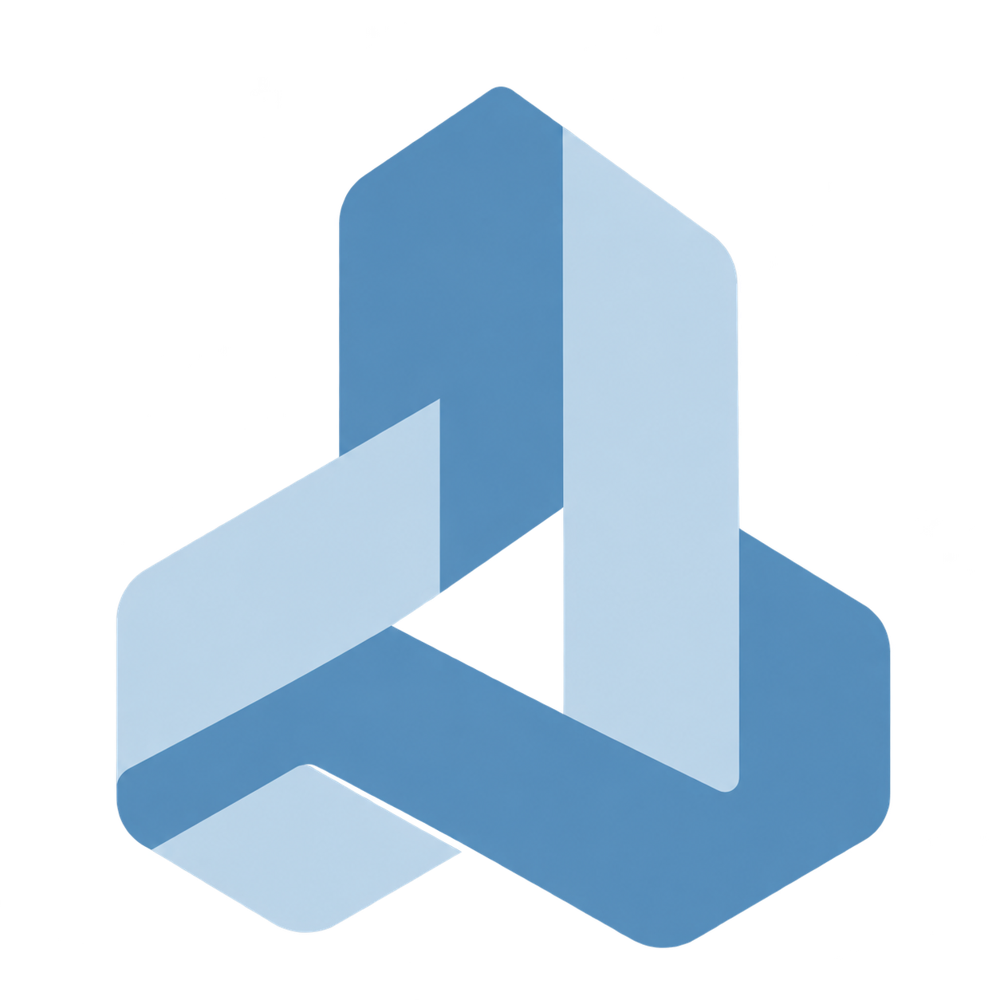
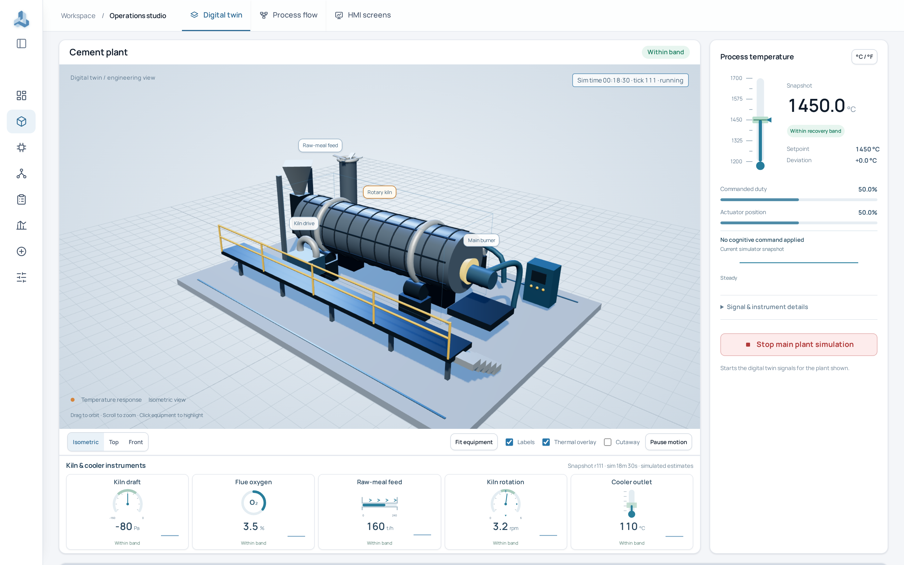
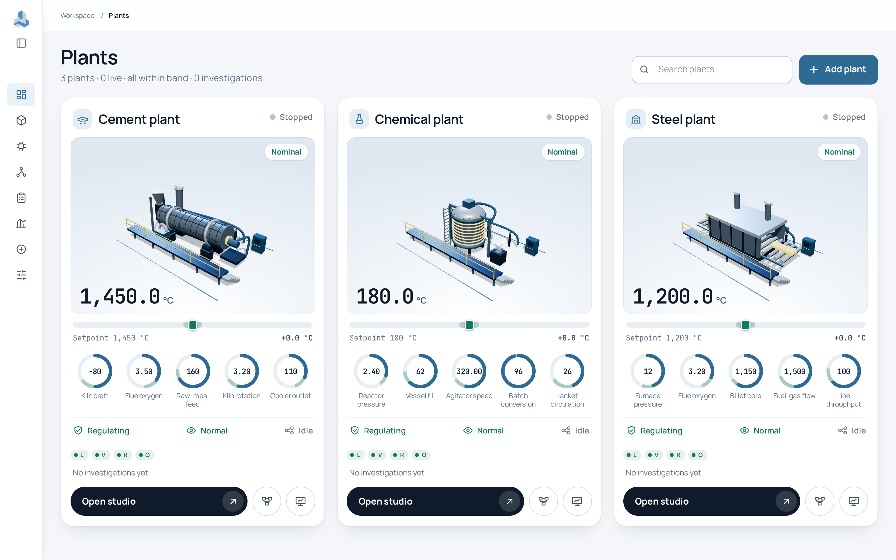

<div align="center">



# Fabrix

### Giving deterministic industrial automation a mind.

Fabrix is a **meta-automation harness** — an intelligence layer that sits on top of the PLCs, DCS and interlocks a plant already runs, reasons about *why* something is happening, anticipates what comes next, and proposes what to do about it.

<br />


<br />

**`cognition proposes · a deterministic gateway validates · the plant executes`**

</div>

---

<div align="center">
  
  <sub><i>Operations studio — the live digital twin, instruments and the cognitive command panel.</i></sub>
</div>

---

## What this is

A working, simulation-based prototype of a cognitive automation platform. It models a **cement kiln**, a **steel reheating furnace** and a **chemical reactor**, watches each with four specialist cores, and lets AI agents investigate faults and propose a fix.

The main investigating agent runs on the **Antigravity SDK**; the four core agents run on **Google ADK**. Both use Gemini.

The rule that holds everything together: an agent can only return **one typed proposal** — a single action, or an escalation. Only the Gateway can change a plant, and it checks every command against live state first. Speed and intelligence buy no exemption.

> [!NOTE]
> Everything is simulated — plants, sensors, cameras, robots and the learned models. Nothing connects to a real PLC, DCS or OT system. See [Limitations](#limitations).

## Contents

- [Architecture](#architecture)
- [The cores: faculties as services](#the-cores-faculties-as-services)
- [What you get](#what-you-get)
- [Quick start](#quick-start)
- [Try it](#try-it)
- [How an incident flows](#how-an-incident-flows)
- [Configuration](#configuration)
- [Deploying](#deploying)
- [Project layout](#project-layout)
- [Development](#development)
- [Limitations](#limitations)

## Architecture

Three ideas carry the design: control and cognition are separated, they run on different timescales with different authority, and only the fastest layer is allowed to touch the plant.

### Two systems, and the boundary between them

Existing automation is fast, precise and context-blind. A cognitive layer is slow, contextual and capable of being wrong. Putting them together safely is the whole design problem — so they are kept apart, with a validating boundary in between.

| Part | Role | In this prototype |
| --- | --- | --- |
| ⚙️ **Control** (System 1) | Existing deterministic automation: precise, tireless, real-time, blind to wider context | The simulated plant with its feedback control and safety cutoff |
| 🧠 **Cognition** (System 2) | An agent layer that brings intention, context and reasoning, and copes with novelty | The main agent harness plus the core agents |
| 🛡️ **Boundary** | Middleware that turns intent into machine commands and enforces safety *before* actuation | The Gateway and the order pipeline |

Cognition never actuates. It can only hand a typed proposal to the boundary, which validates it against live plant state and either executes it or refuses.

### Three layers, by timescale and authority

| Layer | Authority | Timescale | Role | In this prototype |
| --- | --- | --- | --- | --- |
| **Reflexive** | Actuates | µs – ms | Hard real-time control and interlocks. The only layer that actuates. | Simulated feedback control, a high-temperature cutoff and robot zone interlocks |
| **Perceptual** | Observes | ms – s | Learned pattern recognition and prediction | Core monitors and a simulated sensor model, evaluated on every tick |
| **Cognitive** | Proposes | s – min | Reasoning, planning, cross-domain correlation | Agent investigations, which take tens of seconds to minutes |

The cognitive layer does not micro-manage the fast loops. It sets their set-points, monitors them, and steps in when context changes the right answer. In the prototype the lever is the thermal duty set-point, which the reflexive feedback then regulates around.

### Keeping the plant in band

Fabrix holds a set of operational set-points (temperature, throughput, quality, energy) inside their target bands with a closed loop: **sense → reason → validate → act → feed back.** Because it forecasts on a copy of the plant before acting, it can correct a developing deviation rather than only react to one.

### Human authority

Operators can override any recommendation, and the platform records it. When an agent cannot or should not act, it escalates to the operator with its evidence instead of guessing.

## The cores: faculties as services

A core is a specialist faculty that the cognitive layer, and the other cores, can call on demand. They are not wired into every workflow — the agent asks for exactly the faculty a situation needs, when it needs it.

| Faculty | Capacity | Prototype core |
| --- | --- | --- |
| 📈 **Learning** | Learn, model and detect drift in signals | Multi-rate signals fused by a simulated sensor model, with per-channel baselines, spectra and learned bands |
| 👁️ **Vision** | See: measurement and open-ended scene understanding | Camera feeds (placeholder frames or recorded clips) read by a simulated detector |
| 🤖 **Robot** | Feel and act physically | A simulated inspector, maintainer and carrier fleet with zone interlocks, inspection and repair missions |
| ⚖️ **Optimization** | Weigh options against objectives | Twin search and repair-window planning over a copy of the plant. It owns thermal-duty execution. |

Each core has an always-on deterministic monitor, a Google ADK agent woken when the monitor raises an alert, and scoped tools. Agents are switched on with `COGNITION_CORE_AGENTS=true`. If the model is unavailable, the core's deterministic analyser answers and the UI marks it degraded. Cores answer through an in-process bus (the `ask_core` tool), and advisory external A2A specialists can be registered.

<details>
<summary><b>What the prototype covers, and what it does not</b></summary>

<br />

| ✅ Implemented in the prototype | 📐 Described by the architecture, not implemented here |
| --- | --- |
| Propose, validate, execute with a deterministic Gateway | A separate ethical governor above the cognitive layer (its hard-constraint role is covered by the Gateway and the operator controls) |
| Reflexive, perceptual and cognitive layers with tiered loops | The DREAM consolidation process and drift-driven model retraining |
| Agent harnesses (Antigravity SDK, Google ADK) using MCP tools and Agent Skills | A persistent memory and knowledge graph |
| Faculties summoned on demand through `ask_core` | Native physical-AI models (sensor-language, vision-language-action, world models) |
| Anticipatory checks: a twin forecast must recover the plant and beat doing nothing | Negotiated arbitration among competing domain agents |
| Human authority: supervised approval, escalation decisions, Stop and a kill switch | An evolving personality, voice or natural-language briefings |
| A full audit trail and an explainable incident record | Federated learning across sites and deployment topologies beyond a container |
| The same pattern on three industries, with new industries added as packs | |

</details>

## What you get

- 🏭 **Three plants** (cement, steel, chemical) with feedback control, actuator lag, faults and a live world clock.
- 🧩 **Four cores**: Learning, Vision, Robot and Optimization.
- 🤖 **Live AI agents**: the main investigating agent runs on the **Antigravity SDK** and is chosen in the studio; the four core agents run on **Google ADK**. An ADK main-harness adapter is available through the API. Both use Gemini.
- 🖥️ **An operator UI**: a fleet overview, a 3D operations studio (digital twin, process flow, HMI screens), Specialist Faculties, an Agent estate map, Investigations, Impact and an asset registry.
- 🔧 **Repairs with consequences**: lock-out, repair and unlock missions with simulated downtime, spare parts, work orders and a business and sustainability ledger.
- 🛑 **Safety controls**: response modes (observe, supervised, autopilot), Stop, a kill switch, "stop after N verified recoveries", and operator decisions when an agent escalates.

<div align="center">
  
  <sub><i>Plants overview — three industries, one pattern.</i></sub>
</div>

## Quick start

### 🐳 Docker

```bash
cp .env.example .env          # add GOOGLE_API_KEY (or the Vertex AI settings)
docker compose up -d --build
```

Open <http://localhost:8000> (change the published port with `FABRIX_PORT`). Data is kept in the `fabrix-data` volume. Keys are read from `.env` at run time and are never copied into the image.

### 🚀 Local launcher

Requires Python 3.12 or newer.

```bash
bash start.sh
```

On Windows, run `start.cmd`. The launcher creates a single `.venv`, installs the dependencies, creates `.env` if missing, starts the server and opens the browser. Options: `--port 8010`, `--no-browser`, `--setup-only`, `--repair` (Windows: `-Port`, `-NoBrowser`, `-SetupOnly`, `-Repair`).

### 🛠️ Manual

```bash
python -m venv .venv
source .venv/bin/activate     # Windows: .venv\Scripts\activate
pip install -e ".[dev,mcp,adk,antigravity]"
cognition serve               # http://127.0.0.1:8000
```

The command-line tool is called `cognition`, and the settings use the `COGNITION_` prefix.

> [!IMPORTANT]
> The agents need Gemini access: set `GOOGLE_API_KEY` (or the Vertex AI settings) in `.env`, and set `COGNITION_CORE_AGENTS=true` to run the four core agents. **Agent runs make live model calls that can incur charges.** The UI and the whole simulation run fine without a key — only the agent reasoning is disabled.

## Try it

1. Open **Operations studio**, choose a plant, set Response mode to **Autopilot** and the Agent harness to **Antigravity**, then press **Start main plant simulation**.
2. In **Inject disturbance**, pick a fault (for example *Kiln drive bearing wear* on cement, or *Burner out* on steel) and press **Inject**.
3. Watch the Live activity strip: the cores raise alerts and their agents analyse, the main agent investigates, the Gateway validates one action, a robot repairs, and the platform verifies recovery on ten steady samples.
4. Visit **Specialist Faculties**, **Agent estate**, **Investigations** and **Impact** to see the evidence, the agent logs, the incident record and the work order.

Other handy controls: **Stop after N recoveries** ends the run once N recoveries are verified, and **Reset plant** returns it to baseline. When an agent cannot or should not act, the run shows **Needs attention** with its reason — you can **Mark fixed**, **Investigate again**, or **Dismiss**.

## How an incident flows

A monitor or the automation notices a deviation. The main harness investigates with scoped read and simulation tools and can ask the cores for evidence. It returns one proposal. The platform checks the plant scope, revision, expiry, telemetry freshness, control bounds, and a twin forecast that must recover the plant and beat doing nothing. The order then goes to the owning core, and the Gateway or FleetGateway writes the receipt. In live mode the plant keeps ticking during an investigation, so a duty order that has gone stale is re-sized from the live state before it runs. Recovery is then verified on ten fresh in-band samples.

**Guarantees**

- Only `Gateway.execute` writes plant state, and only `FleetGateway` writes robot missions.
- Commands are idempotent by id and proposal digest.
- Monitors and analysers use sensor-derived evidence only. They never read injected-event labels.
- No hidden retries. A failed run ends as `failed` or `interrupted` and is never re-run silently.
- Exception messages are never stored, because they can contain credentials. Only the exception type is recorded.
- Automation is never re-enabled on restart.

## Configuration

Copy `.env.example` to `.env`. Process environment variables take precedence over `.env`. Restart after editing.

| Setting | Purpose | Default |
| --- | --- | --- |
| `GOOGLE_API_KEY`, `GEMINI_MODEL` | Gemini access and model id | none |
| `GOOGLE_GENAI_USE_VERTEXAI`, `GOOGLE_CLOUD_PROJECT`, `GOOGLE_CLOUD_LOCATION` | Vertex AI instead of an API key | `false`, none, `us-central1` |
| `COGNITION_DB` | SQLite database path | `data/platform.db` |
| `COGNITION_TIMEOUT` | Seconds allowed for one main-harness investigation | `120` |
| `COGNITION_CORE_AGENTS` | Run the Google ADK core agents (live model calls) | `false` |
| `COGNITION_CORE_MODEL` | Model for the core agents | `GEMINI_MODEL` |
| `COGNITION_CORE_RUN_SECONDS` | Wall-clock ceiling for one core run, `0` is off | `600` |
| `COGNITION_KILL_AFTER_SECONDS` | Stop every agent this long after a run starts, `0` is off | `0` |
| `COGNITION_LIVE_DRIFT` | Plant revisions a proposal may lag behind | `300` |
| `COGNITION_STRICT_MODE` | Freeze sampling during investigations, exact revisions | `false` |
| `COGNITION_TOOL_CAP` | Main-harness tool calls per incident | `200` |
| `COGNITION_WORLD_AUTOSTART` | Start every plant's world clock at launch | `false` |
| `COGNITION_HOST`, `COGNITION_PORT` | Listen address of `cognition serve` | `127.0.0.1`, `8000` |
| `COGNITION_<NAME>_PYTHON` | Run a harness (`ADK`, `ANTIGRAVITY`) in a child process using this environment | blank (in-process) |

> [!WARNING]
> **Never commit your `.env` file.** It is listed in `.gitignore` — keep it that way. Only `.env.example`, which holds no values, belongs in version control.

## Deploying

The image runs one `cognition serve` process.

> [!CAUTION]
> **The API has no authentication.** Do not expose it directly to the internet. Put it behind an authenticating reverse proxy, a VPN, or a platform with identity checks.

- Run a **single instance**: runs, the world clock and the agents live in one process and in SQLite.
- Keep **CPU always allocated** on serverless platforms, or the simulation stalls between requests.
- Treat storage as **ephemeral** unless you mount a persistent volume for `/data`.
- Give streaming (server-sent event) endpoints a long request timeout and no response buffering.

### Command-line tools

```text
cognition serve [--host H] [--port P]   start the UI and API
cognition mcp                           read-only stdio MCP facade
```

The stdio MCP facade needs the API running and offers `list_plants`, `discover_capabilities` and `predict_action`. It exposes no plant writer.

## Project layout

| Path | Responsibility |
| --- | --- |
| `src/cognition/domain.py` | Typed contracts: state, proposals, receipts, orders |
| `src/cognition/api/` | FastAPI app, schemas and grouped routers |
| `src/cognition/runtime/` | Incident lifecycle, automation, world clock, orders, UI read models |
| `src/cognition/control/` | Gateway, maintenance rules, fleet gateway, connectors |
| `src/cognition/simulation/` | Thermal model and fault engine |
| `src/cognition/industries/` | Cement, steel and chemical packs: signals, faults, tools, skills |
| `src/cognition/layers/` | Reflexive, perceptual and cognitive layers |
| `src/cognition/cores/` | Learning, vision, robot and optimization cores |
| `src/cognition/harnesses/` | Harness contract and the Antigravity and ADK adapters |
| `src/cognition/mcp/` | MCP servers (incident-local, private command server, stdio facade) |
| `src/cognition/business/`, `sensing/` | Business and sustainability model, signal, camera and fleet simulators |
| `src/cognition/insights/` | KPIs, impact ledger, reports, work orders, recommendations |
| `src/cognition/persistence/` | SQLite store and audit trail |
| `src/cognition/web/` | The UI: vanilla JavaScript, vendored Three.js, no build step |
| `scripts/` | Setup, SDK checks and packaging helpers |
| `tests/` | Pytest suite |

## Development

```bash
ruff check .
ruff format --check .
mypy src/cognition
pytest -q
python scripts/core_docs.py     # regenerate the core tool and skill tables
```

Tests never make live model calls. Each core has its own README under `src/cognition/cores/<core>/`.

## Limitations

- Everything is simulated: plants, sensors, cameras, robots and the learned models. The plants are educational thermal surrogates, not calibrated digital twins, and nothing connects to real PLC, DCS or OT systems.
- Business factors, prices and emission factors are placeholders.
- There is no operator authentication or role-based access. Supervised approval is a local workflow.
- One application process is assumed. Distributed worker leases are not implemented.
- Worker isolation separates dependencies and makes cancellation clean. It is not a sandbox for untrusted code.
- Live model calls depend on credentials, quota and model availability, and can incur provider charges.
- Detection and attribution are by signal, so an alert may name a neighbouring equipment group.

---

<div align="center">
<sub>Built as a working prototype. All plant data, sensors, cameras and robots are simulated.</sub>
</div>
